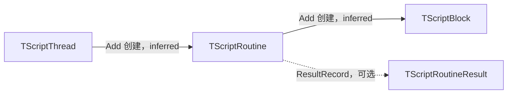

# 20 — 类型元信息、上下文结构与逻辑规则

2026-11-07，P1 第九轮。补足上下文创建和结果记录的证据，仍未执行游戏或脚本，没有实现运行时、播放器或界面。所有真实结论只针对已固定摘要的第四作主程序候选，不认证纯净发行版，也不外推其他 QLIE 版本。

## 有边界限制的类型信息探针

原 EXE 保留了部分 Delphi 类型元信息。`tools/delphi_metadata.py` 只读取计划中 4 个 VMT 和 1 个记录类型，没有全文件导出或通用类加载功能。格式依据是 Delphi 官方的[对象和 VMT 布局](https://docwiki.embarcadero.com/RADStudio/Sydney/en/Internal_Data_Formats_(Delphi))、[方法记录](https://docwiki.embarcadero.com/Libraries/Athens/en/System.TypInfo.TVmtMethodEntry)、[方法扩展记录](https://docwiki.embarcadero.com/Libraries/Athens/en/System.TypInfo.TVmtMethodExEntry)及[字段扩展记录](https://docwiki.embarcadero.com/Libraries/Athens/en/System.TypInfo.TFieldExEntry)。参考版本和用途见 `delphi-metadata-references.json`，没有复制供应商的 RTL 实现。

探针核对 VMT 自指针、类名、TypeInfo 的类指针、源文件范围、方法目标所在可执行段、槽位和字段边界。类字段只支持本次观察到的零 legacy-count 扩展表；记录只支持已审阅的零前缀布局。成员数、符号长度、属性长度、递归深度和总读取量都有上限，未知布局明确拒绝。

本次元信息访问累计 6,790 字节，包含校验时的重复读取，不是唯一区间大小；源 EXE 另作完整读取以核对 SHA-256。得到 4 个类、28 个方法声明、20 个类字段，以及一个含 10 个字段、5 个受管理字段描述的记录。字段名称和地址等原始值有字节引用；解释仍保留 `inferred`。精确编译器版本为 `not_tested`。

## 两层创建关系已找到

| 元信息中的类型名 | VMT | Win32 声明大小 | `+0xc` 槽 / 创建路径 |
|---|---|---:|---|
| `TScriptDataListInterface` | `0x6a77fc` | 12 | 抽象入口，存在 thunk 差异 |
| `TScriptThread` | `0x6a8440` | 16 | `0x6c11d4`，创建例程 |
| `TScriptRoutine` | `0x6a802c` | 112 | `0x6c1074`，创建控制块 |
| `TScriptBlock` | `0x6a7a98` | 68 | 本探针仅列 3 个正向槽，不把后面的数据误认作第 4 槽 |

独立线性反汇编显示：线程 Add 读取例程类的自指针单元并调用其构造函数，然后加入列表；例程 Add 同样创建控制块并加入列表。两个方法都在加入后检查数量与 `0x400` 的关系；错误处理及是否回滚尚未验证，不能据此宣称已实现完整栈上限行为。

下面是由元信息和创建指令形成的概念关系，箭头含义仍是静态解释：



类型名中的 Thread 不证明它对应操作系统线程。这里的 Win32 大小也不是 macOS ARM64 的结构体大小，不能直接作为原生运行时 ABI 或存档布局。

## 先前不透明的恢复字段获得声明名称

控制块的元信息标出：

| 字段偏移 | 声明名称 |
|---|---|
| `+0x04` / `+0x08` | `FLabelName` / `FLowerLabelName` |
| `+0x0c` / `+0x10` | `FSrcFile` / `FLowerSrcFile` |
| `+0x14` | `Option` |
| `+0x34` | `State` |
| `+0x38` / `+0x3c` | `Line` / `Pos` |

这与第八轮恢复路径读取的偏移相吻合。声明名称是元信息事实，但 Line/Pos 的单位、起点和它们与研究副本字节偏移的对应仍未验证，不能直接将其解释为 UTF-8 字节位置。

例程字段还给出 `Scope`、`State`、等待/跳转/事件相关字段，以及 `ResultRecord`。初始化函数的派生视图显示清理控制块、重置字段及释放结果记录的路径；对象别名、事件调度及完整析构效果仍未闭合。

## 额外恢复对象是结果记录候选

记录的元信息名称为 `TScriptRoutineResult`，声明大小 268 字节，与此前 `MakeResult` 分配的 `0x10c` 一致。字段如下：

| 名称 | 偏移 | 本次类型信息范围 |
|---|---:|---|
| `ResultStr` | `0x00` | 16 项数组，元素类型名 `string` |
| `ResultInt` | `0x40` | 未发出类型引用，保留未知 |
| `ResultObj` | `0x80` | 16 项数组，元素类型名 `string` |
| `ResultBtn` | `0xc0` | 类型名 `string` |
| `ResultBtnInt` | `0xc4` | 未发出类型引用，保留未知 |
| `ResultBtnStr` | `0xd4` | 4 项数组，元素类型名 `string` |
| `ResultClkInt` | `0xe4` | 类型名 `Integer` |
| `ResultStopInt` | `0xe8` | 类型名 `Integer` |
| `ResultSubInt` | `0xec` | 未发出类型引用，保留未知 |
| `ResultSubStr` | `0xfc` | 4 项数组，元素类型名 `string` |

受管理字段描述与扩展字段表的偏移、类型引用也做了交叉检查。记录字段解析参考 [TRecordTypeField](https://docwiki.embarcadero.com/Libraries/Athens/en/System.TypInfo.TRecordTypeField) 和 [TManagedField](https://docwiki.embarcadero.com/Libraries/Athens/en/System.TypInfo.TManagedField)；本次零前缀的完整含义没有猜测。

第八轮保存/恢复函数中的寄存器名称与该记录存在对应线索，但命名并非完全一致，例如方法中出现 `ResultBtnObj`，记录字段名为 `ResultBtn`。因此没有用名字自动生成全部绑定，也没有仅凭 `ResultObj` 这个名字将其当作原生对象指针。

目前更有依据的 **Hypothesis** 是：`subr` 的额外状态与结果寄存器恢复有关。它是否还牵涉外部对象、事件或其他副作用仍需核对；这里不是原版存档兼容证明。

## 默认 Ghidra 覆盖缺口与派生视图

默认 REA/Ghidra 没有找到 6 个相关函数的函数体。初始 8 次查询因此失败；REA 会在找不到函数时尝试文件偏移解释，最终返回 `invalid_request`。后续改用明确的地址覆盖查询，确认是没有包含函数，而不是把失败算作空函数成功。

`native-rtti-plan.json` 包含 20 项有效观察，其中 6 项明确观察到缺少函数。独立命令重取 20 项成功、错误 0、清理完成，evidence ID 与 MCP 观察一致。`rtti-native-report.json` 同时保留 8 次历史失败，`default_function_coverage_status=unsupported`，不能将“观察成功”说成“所有函数可反编译”。

随后复用现有 `ghidra_tail_probe.py`：先通过合成正例和错误续接反例，再在一次性数据库中按元信息地址定义 6 个函数。计划的 `cleanup_returns` 为空，实际 `metadata_overrides` 均为零，没有修改 RET 正常流，也没有改程序字节。

6 个定义后的函数可生成派生视图，内存摘要保持一致，结果为 `inferred`。其中名为 baseline 的视图已处于“定义入口之后”，不是未经提示的默认发现结果；伪代码类型和完整调用约定也没有因此升级为已验证。所有方法均不要求模型返回值，这不是对其完整 ABI 的承诺。原始机器指令仍以独立窗口和源摘要追溯。

初次较宽窗口还在 `0x6c1251`、`0x6c10f1` 产生未知解码，位于 Add 尾部 RET 后的探查范围。本轮依据已观察的尾部缩小窗口；旧窗口和两个 Unknown 继续保留在 `exploratory_windows`，没有将它们解释成可执行语义。

## 逻辑规则与短路边界

对照此前运算符映射，两个逻辑助手均要求数值描述符，并将数值字段与 **1** 比较，再写规范化的 0 或 1。表达式核心在调用助手前先后解析两个操作数，没有在这两次解析之间按左值跳过右值的分支。四项指令事实记录在 `native-rtti-facts.json`。

由此得到的候选契约是“精确的整数 1”与“双侧解析”，不是宿主语言的任意非零判断。完整可达性、子表达式归约、错误回滚及动态展开后的全部短路行为仍为 `not_tested`。本轮没有编写布尔执行器或用自造真值表冒充原程序执行测试。

## 尚未支持及复现

元信息探针保留 28 个未解析的方法签名尾部、3 个缺少类型引用的记录字段，以及 1 处抽象 Add 的方法入口/虚槽差异。该差异的原始入口是跳转 stub，探针没有自动消除别名，所以 `metadata_binding_coverage_status=unsupported`。两个早期猜测的非 VMT 地址也作为负例被拒绝；该结果只证明拒绝发生，不算作游戏格式兼容成功。

所有原始视图和工具日志在 `private/p1-round9/`；公开报告只保留声明名称、来源、摘要、统计和明确限定。新探针不实例化对象、不调用虚方法、不解密存档，也不修改源文件。

```sh
.venv/bin/python tools/delphi_metadata.py \
  --game-dir "$GAME_DIR" --exe "$GAME_EXE_REL"
.venv/bin/python tools/rea_static.py \
  --game-dir "$GAME_DIR" --exe "$GAME_EXE_REL" \
  --plan docs/native-rtti-plan.json \
  --output private/p1-round9/native-reproduced \
  --rea-command "$REA_COMMAND" \
  --java-home "$JAVA_HOME" --ghidra-dir "$GHIDRA_INSTALL_DIR"
.venv/bin/python tools/native_windows.py \
  --game-dir "$GAME_DIR" --exe "$GAME_EXE_REL" \
  --plan docs/native-rtti-windows.json --output private/p1-round9/windows
.venv/bin/python tools/ghidra_tail_probe.py --synthetic \
  --private-dir private/p1-round9/entry \
  --ghidra-dir "$GHIDRA_INSTALL_DIR" --java-home "$JAVA_HOME"
.venv/bin/python tools/ghidra_tail_probe.py \
  --game-dir "$GAME_DIR" --exe "$GAME_EXE_REL" \
  --plan docs/native-rtti-entry-plan.json \
  --private-dir private/p1-round9/entry --public-report rtti-entry-report.json \
  --ghidra-dir "$GHIDRA_INSTALL_DIR" --java-home "$JAVA_HOME"
.venv/bin/python tools/review_native.py \
  --game-dir "$GAME_DIR" --exe "$GAME_EXE_REL" \
  --plan docs/native-rtti-plan.json --facts docs/native-rtti-facts.json \
  --evidence-dir private/p1-round9/native-reproduced \
  --windows-dir private/p1-round9/windows \
  --output reports/p1/rtti-native-report.json
.venv/bin/python tools/research_checks.py --stage round9 \
  --game-dir "$GAME_DIR" \
  --artifact reports/p1/delphi-metadata-report.json \
  --artifact reports/p1/rtti-entry-report.json \
  --artifact reports/p1/rtti-native-report.json
```

如需重现本机的探索历史，`review_native.py` 还可接收 `--attempts-file private/p1-round9/default-query-errors.json` 和 `--exploratory-windows-dir private/p1-round9/windows-broad`。它们是历史输入，不影响已选定的指令事实；未知和失败仍保留。

新增 12 项无商业数据的 PE/RTTI 测试，覆盖身份交叉检查、槽位差异保留、范围和预算限制、字段和记录布局、未知属性、签名尾部及截断拒绝。最终检查见 `round9-tests.json` 和 `round9-readiness.json`。下一步可将声明中的状态枚举与分支转移关联，继续核对事件和结果绑定；完整游戏运行、音画演出和存档仍未完成。

实际研究环境 169 项通过；系统 Python 166 项通过、3 项可选检查跳过；上游 26 项通过、8 项商业夹具检查跳过。合成正反例、六个真实入口模型和 unittest 分开记录。20 个已有摘要的原始关键文件及全部冻结 P0 报告与本轮开始前快照一致，完整商业数据和原生视图仍只在被 Git 忽略的目录中。
